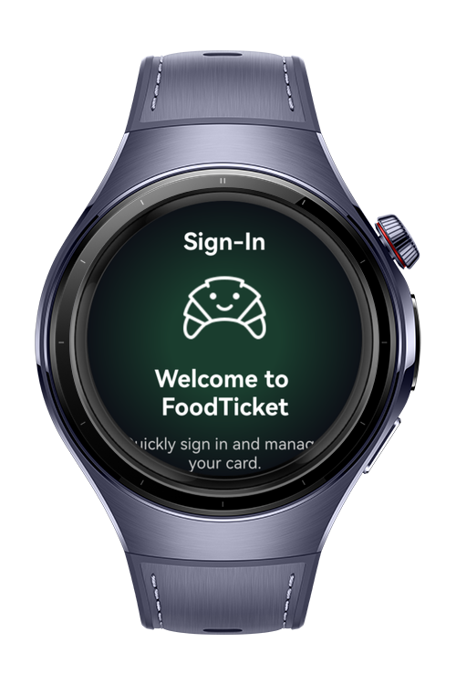
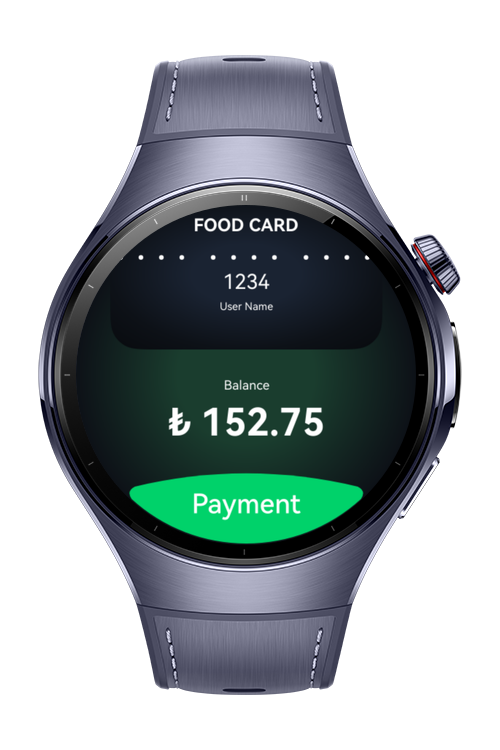
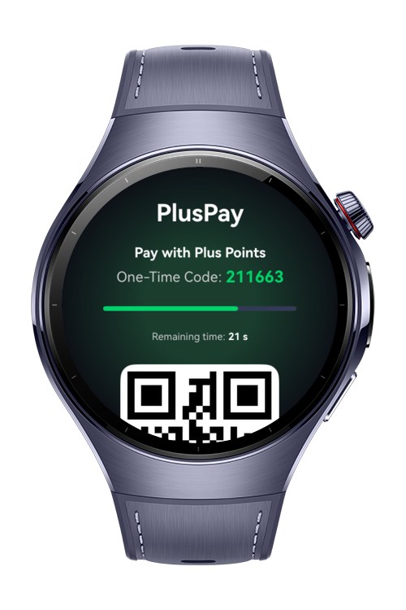
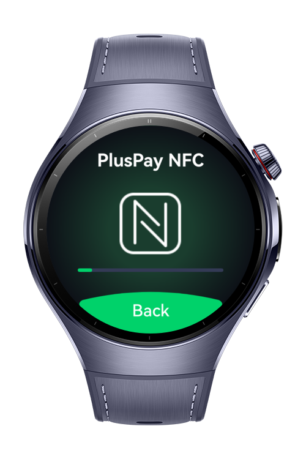

> **Note:** To access all shared projects, get information about environment setup, and view other guides, please visit [Explore-In-HMOS Index](https://github.com/Explore-In-HMOS/hmos-index).

# FoodTicketCard

OTP-based Payments, NFC, and Campaign Notifications for HarmonyOS NEXT

FoodTicketCard provides secure authentication with user login and OTP verification; it combines Payment/PlusPay and NFC contactless payment flows. The app keeps users informed about the latest offers through rotating food campaign notifications.

# Preview

<p align="center">
  
  
  
  
</p>

# Use Cases
- Secure user login (email or phone) and OTP (one‑time password) (otp password:123456) verification.
- View balance and access key actions quickly from the main page.
- Fast and seamless checkout with PlusPay.
- Contactless payment via NFC (on supported devices), with animations, progress, and user feedback near POS.
- Periodic food campaign notifications to surface current deals.
- Visual and haptic feedback during verification and payment steps.

# Technology

## Stack (Languages, Frameworks, Tools, Libraries)
- Languages & Frameworks: ArkTS (HarmonyOS NEXT)
- HarmonyOS Kits:
  - ArkUI (declarative UI, Navigation, inputs, buttons, progress, scroll)
  - NotificationKit (publishing campaign notifications)
  - AbilityKit (optional: deep-link routing for notification actions)
  - ConnectivityKit (NFC reader mode and ISO‑DEP interaction)
  - (Optional) Vibrator API (haptic feedback)

## Required Permissions
Requirements may vary by device/SDK:
- Notifications: ohos.permission.POST_NOTIFICATION (may not be required for foreground notifications on some setups)
- NFC: device NFC core and ISO‑DEP support (SystemCapability.Communication.NFC.Core)

## Diagrams – Process
```sequence
User->FoodTicketCard App: Launch & Login
App->Auth: Validate email/phone, send OTP
User->FoodTicketCard App: Enter OTP (countdown, request new code)
App->User: If OTP is correct, navigate to Main/Payment
App->Notification: Publish rotating mock campaign notifications (every 30s while foreground)
User->FoodTicketCard App: Start NFC payment (approach POS)
App->NFC: Reader Mode & ISO-DEP interaction, success feedback (toast/vibration)
App->User: Transaction completed message and return
```

## Tech Summary
- ArkTS: Declarative UI and business logic across Login, OTP, Main, Payment, PlusPay, and NFC.
- HarmonyOS Kits: NotificationKit, ConnectivityKit (NFC), AbilityKit (optional), PerformanceAnalysisKit.

# Directory Structure
```text
FoodTicketCard/
├── entry/
│   └── src/
│       └── main/
│           ├── ets/
│           │   ├── pages/
│           │   │   ├── Index.ets            # Navigation & campaign ticker (every ~30s in foreground)
│           │   │   ├── LoginPage.ets        # Email/phone validation, UX feedback
│           │   │   ├── OTPPage.ets          # 6-digit OTP, countdown & resend flow
│           │   │   ├── MainPage.ets         # Card summary, balance, navigation to payments
│           │   │   ├── PaymentPage.ets      # Payment flow
│           │   │   ├── PlusPayPage.ets      # PlusPay flow
│           │   │   └── NFCPaymentPage.ets   # NFC reader mode, ISO-DEP transmit, feedback
│           │   ├── services/
│           │   │   └── NotificationService.ets   # Campaign notification publishing
│           │   ├── data/
│           │   │   └── Campaign.ets              # Mock campaign data
│           │   └── resources/                    # Assets & localization
├── docs/                                         # Documentation
└── tests/                                        # Unit & integration tests
```

# Constraints and Restrictions
## Supported Devices
- Target: HarmonyOS NEXT devices (phones; contactless payments on NFC‑capable models)
- Form Factors: Phone‑optimized layouts; adaptable to other form factors.

- Notification Behavior
  - Rotating campaign notifications are scheduled while the app is in the foreground. Background periodic notifications are subject to OS scheduling constraints and minimum intervals.

- Battery & Performance
  - Frequent notifications and NFC scanning/animations can increase resource usage; follow platform best practices.

- Localization
  - Default text in English; integrate HarmonyOS localization for additional languages.

- Security & UX
  - OTP flow provides clear visual feedback (countdown, validation messages).
  - NFC payments offer visual and haptic feedback (progress, toast, vibration).

# License (MIT)

FoodTicketCard is distributed under the terms of the MIT License. See the [LICENSE](./LICENSE) file for more information.